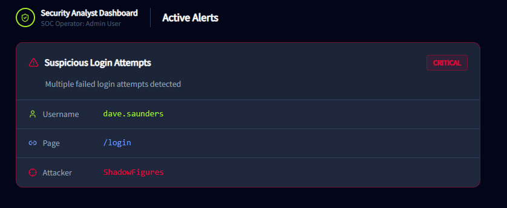
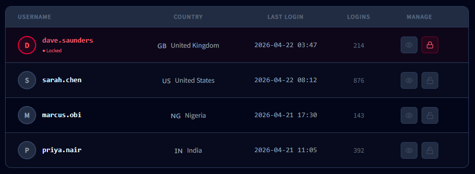
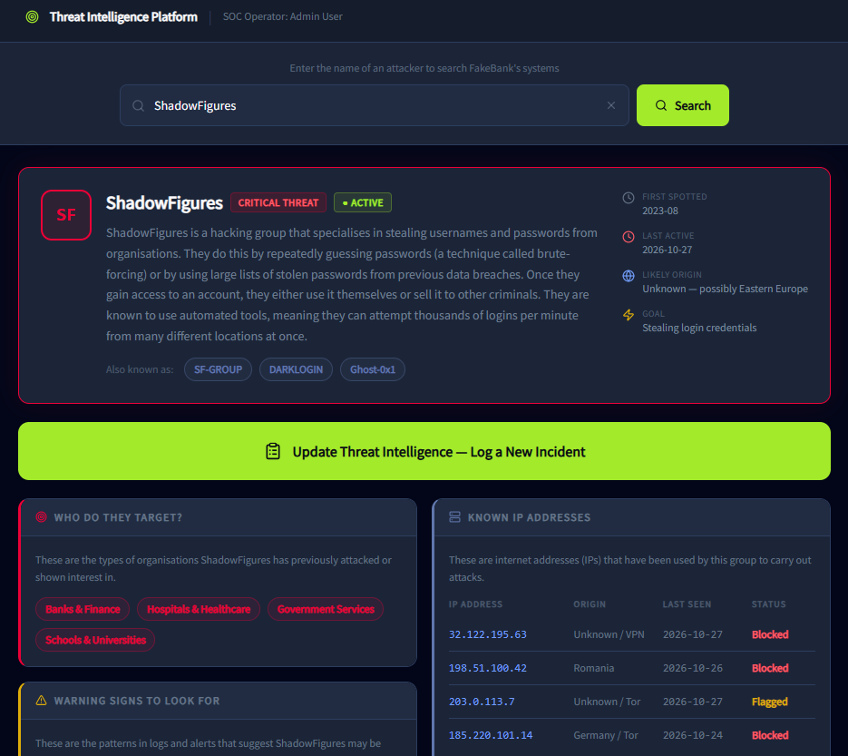
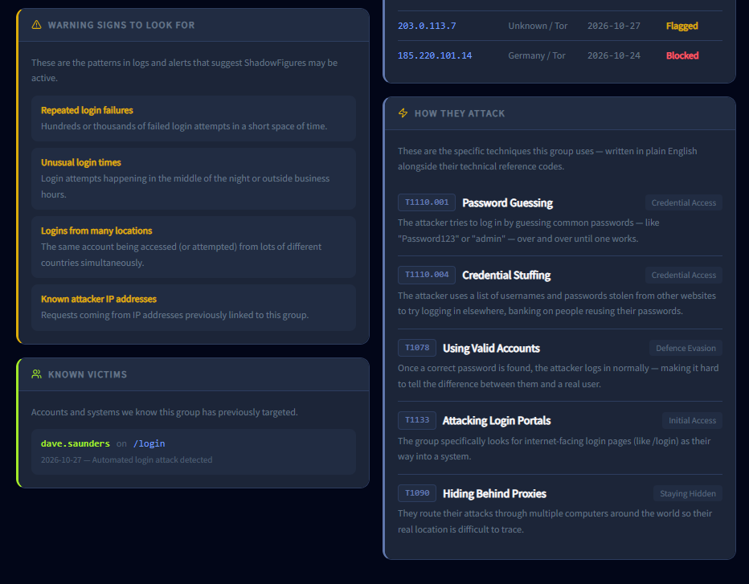
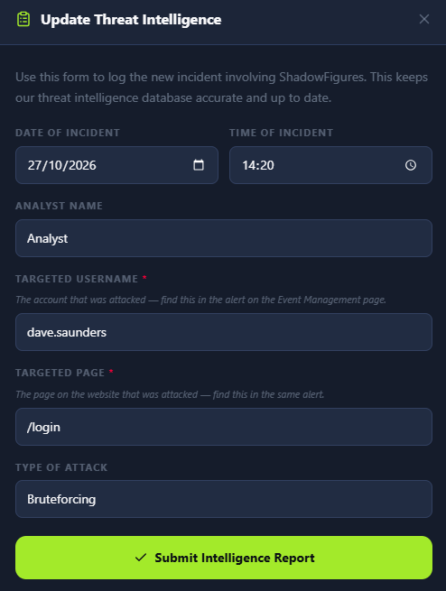
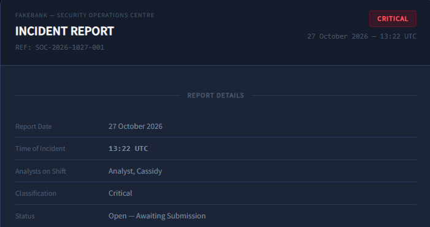

# TryHackMe - Defensive Security Intro

## What is Defensive Security
Defensive Security is the practice of protecting an organization's systems by monitoring for threats, using threat intelligence to understand attackers, and responding to incidents when they happen.

## Task: Reviewing a suspicious login alert
**Situation:** It's Monday. I open Fake Bank's SOC (Security Operations Center) together with my coworker, and we come across hundreds of login attempts on the system.

**Question:** Review the "Suspicious Login" alert. What username is being used?

**Answer:** `dave.saunders`

## Task: Locking the compromised account
We need to stop the attack as quickly as possible. To do that, we lock the `dave.saunders` account.

**Question:** Lock the `dave.saunders` account by clicking the padlock icon next to the name. What value (flag) has appeared once this was done?

**Answer:** `THM{ACCOUNT-LOCKED}`

## Task: Updating threat intelligence
The monitoring dashboard suggested the attacker might be the ShadowFigure group, which has been attacking banking organizations before, meaning this wasn't their first attack. In defensive security, we share information about attacks between organizations; this is known as **threat intelligence**.

Now we use Fake Bank's threat intelligence system to document what ShadowFigure just did, so other organizations can be warned.

**Question:** Update FakeBank's systems to include what page and username ShadowFigures tried to hack. A green success message will appear. What is the value (flag) of that?

**Answer:** `THM{INTEL-UPDATED}`

## Task: Submitting an incident report
Now we need to create an incident report documenting what happened.

**Question:** What is the identifier of the incident report that you submit?

**Answer:** `SEC-2026-341`

## What I learned
- SOC alerts (like "Suspicious Login") are the first signal that something is wrong and need to be reviewed quickly to identify the account and method under attack.
- Locking a compromised account is a fast containment step that stops an ongoing attack while a deeper investigation happens.
- Threat intelligence is the practice of sharing information about attackers (who they are, what they target, how they operate) between organizations, so everyone can defend against the same threat actor.
- Every incident should end with a documented incident report, so the response can be tracked, reviewed, and used to improve future defenses.
