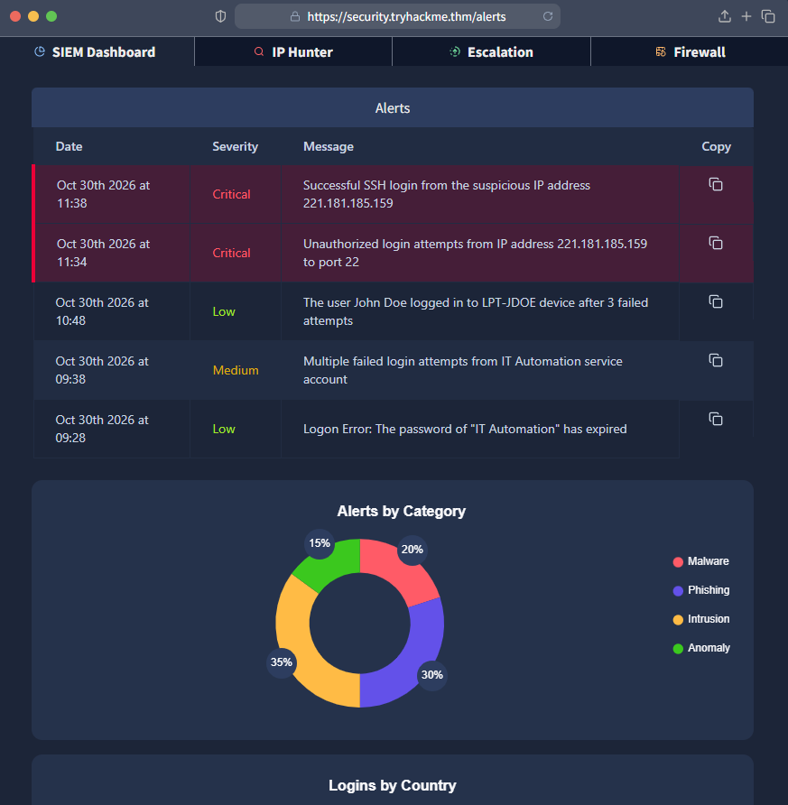
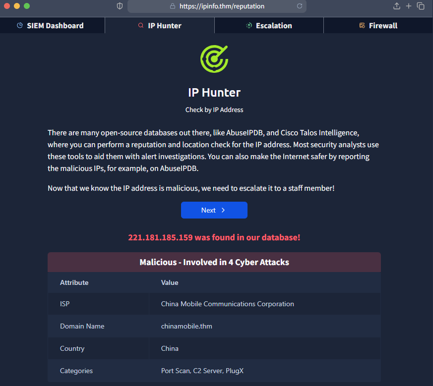
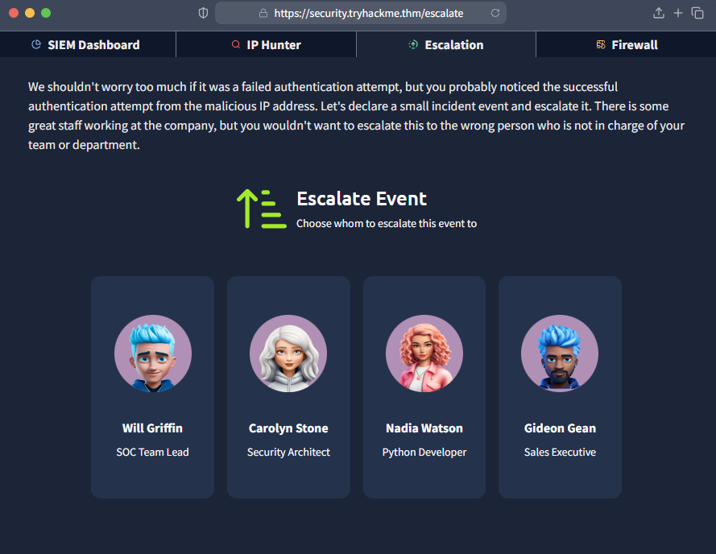
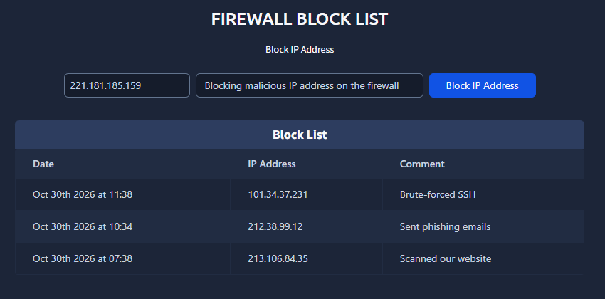

# TryHackMe - Junior Security Analyst Intro

I start the day reading the cybersecurity news from the last week, seeing what I can improve in the company's security with the new things that came up. I'm the first line of defense, and every day I protect the company from appearing in the cyber news.

As a Junior Security Analyst, I'm also called a SOC level 1 (Security Operations Center).

SOC engineers configure the security tools, senior analysts help with complex attacks, and the manager tries to keep everything under control. A Security Operations Center is the big team that protects the company.

## The team
- **Senior Analyst:** Helps junior analysts when something isn't clear and handles complex cases after the junior analyst does the initial analysis
- **SOC Engineer:** Doesn't have shifts and doesn't analyze alerts. Keeps the security tools maintained and configures alerts to make the analysts' job easier
- **SOC Manager:** Tries to keep everything under control. Reports the SOC's results to top management and makes sure the junior analyst doesn't get lost in this new, big world of cybersecurity
- **Incident Responder:** The junior analyst doesn't need to work with them every day, but when the incident responder is online, you know something serious happened. They're called on demand during major incidents.

On the path to growing in cybersecurity, the challenges should be:
- detecting and preventing data theft infections on colleagues' computers
- analyzing and stopping a phishing campaign targeting the finance team
- participating in larger incidents, like a full-scale ransomware attack
- teaming up with colleagues to build detection rules and automations
- going between cyber and understanding how companies operate from the inside

## A day in the life of a security analyst
You'll need to learn new things constantly. During a tiring 8-hour shift, you have to get through a mountain of tickets, alerts and tasks that you need to resolve in a timely manner. Still, the work is fun and rewarding, especially after stopping a real threat from damaging your organization. Even better, it's fascinating to know how attacks you hear about in the news actually happen in real life.

## Task: Investigating a malicious IP
This is a SIEM Dashboard.

**Question:** What was the malicious IP address in the alerts?

**Answer:** `221.181.185.159`

I switched to the IP Hunter page.

I click Next:

**Question:** To whom did you escalate the alert with the malicious IP?

**Answer:** `Will Griffin - SOC Team Lead`

After sending it to Will to analyze the alert in more detail, I got permission to block the malicious IP address on the firewall to stop or slow down the attack.

**Question:** What message did you get after blocking the IP address on the firewall?

**Answer:** `THM{until-we-meet-again}`

## What I learned
- A SOC team has different roles with different responsibilities: junior analysts (SOC level 1) handle first-line alerts, senior analysts take on complex cases, engineers maintain the tools, and the manager reports results and keeps things organized.
- A SIEM dashboard is where alerts first show up, and tools like an IP reputation lookup help confirm whether an IP is actually malicious before acting on it.
- Escalating correctly matters. Knowing who is responsible for a given area (like the SOC Team Lead) is part of the job, not just detecting the threat.
- Blocking a malicious IP on the firewall is a concrete containment action a junior analyst can take once they have the right permission and context.
