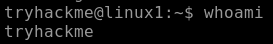
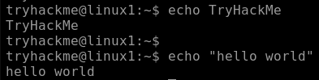
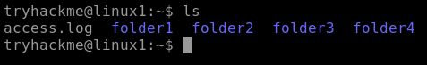
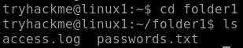
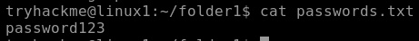
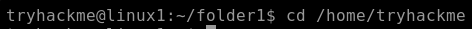
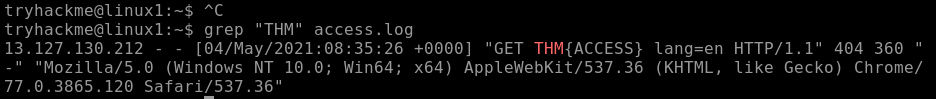
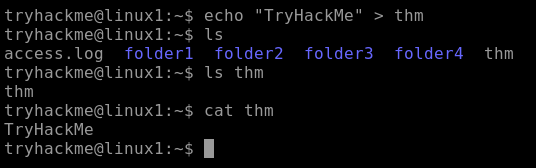
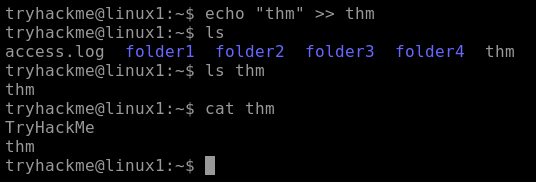

# TryHackMe - Linux Fundamentals (Pt 1)

## What is this room about
This room is an introduction to using Linux through the terminal: deploying a first Linux machine, basic navigation, searching for files and text, and combining commands with shell operators.

## Task: Talking to Linux
Using the `whoami` command. This command matters because, when working in cybersecurity, we'll eventually need to switch users, which determines what we can and can't do.

We can make the terminal print a message with `echo`, for example `echo TryHackMe`. For multiple words, we need to use quotes, like `echo "hello world"`.

Using `echo` is the start of a very important skill in cybersecurity: being able to create output and send it somewhere. We can also use the keyboard arrows to scroll through previously used commands.

## Task: Finding Your Way Around
We can navigate the system without ever touching a mouse. These are 4 commands that handle almost all navigation:

- `ls` - list the current folder
- `cd` - change directory - move into a folder
- `cat` - show the contents of a file
- `pwd` - print working directory - "where am I?"

In Linux, files and folders are shown in different colors, which makes it easier to identify what each thing is. Folders are shown in blue.

In the lab, we run `ls` to see what's in the home folder.

**Question:** How many folders are there?

**Answer:** `4`

**Question:** One of those folders contains a file. Which folder is it?

To answer, we need to use `cd` to change folder, then `ls` to see what's inside the folder we entered.

Inside `folder1` we find a file, so we can answer the question.

**Answer:** `folder1`

**Question:** Use `cat` to read the file within this folder. What does it say?

We can now use the `cat` command to show the contents of any file.

We can read the file with `cat`, and it shows `password123`.

**Answer:** `password123`

## Task: Let the Machine do the Searching
We can use the `find` command to search for files by name, for example `find -name passwords.txt`.

The `grep` command searches inside files for text, for example `grep "password123" passwords.txt`.

In the lab, there's a web server log file in the home folder called `access.log`, with hundreds of lines. Somewhere in the log, there's a flag.

To go to the home folder, we use `cd` with the username:

Now we use `grep` to search the log file:

**Question:** After using `grep "THM" access.log` a flag was found. What is the flag?

**Answer:** `THM{ACCESS}`

## Task: Shell Operators (Combining Commands)
In Linux, some special characters can be used to combine commands. They're called "operators", and they tell Linux how to process the two commands.

- `&` - runs the command, but doesn't wait for it to finish before you can do something else. The command runs in the background, which is useful for commands that take a while to complete, or ones you want to keep running.
- `&&` - runs both commands, but waits for the first one to finish before starting the next, like a set of dominoes.
- `>` - used to redirect output. We can take the output of a command and send it to a file. This operator will overwrite anything already in the file.
- `>>` - this redirector does the same thing, but instead of overwriting, it just appends the output to the bottom of the file.

For example, `echo hey > welcome` creates a file `welcome` containing "hey". We can use `cat welcome` to check it worked.

Let's, in one line, use `echo` to print the text "TryHackMe" and use the `>` redirector to store it in a file called `thm`.

Besides creating the `thm` file, I also navigated to it with `ls` and used `cat` to verify it contained the text I wrote.

Now I'll do the same using the `>>` redirector with the text "thm":

We can see that it didn't overwrite the previous text.

**Question:** What operator waits for the first command to finish before the next command?

**Answer:** `&&`

**Question:** What redirector allows us to save the output without overwriting the contents of a file?

**Answer:** `>>`

## What I learned
- `whoami` tells you which user you're operating as, which matters because permissions in Linux (and therefore what you're allowed to do) depend on the current user.
- `ls`, `cd`, `cat` and `pwd` cover almost all basic navigation and file-reading in a Linux terminal, no GUI required.
- `find` searches for files by name, while `grep` searches for text inside files — a fast way to locate a specific flag or string buried in a large log file.
- Shell operators (`&`, `&&`, `>`, `>>`) let you chain and control commands: run something in the background, run commands in sequence, or redirect output to a file (overwriting with `>` vs. appending with `>>`).
