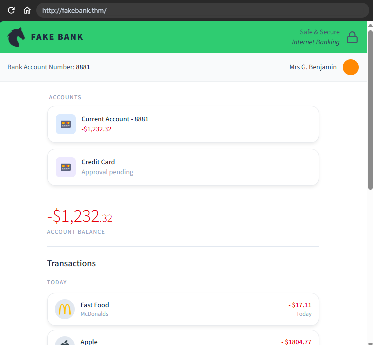
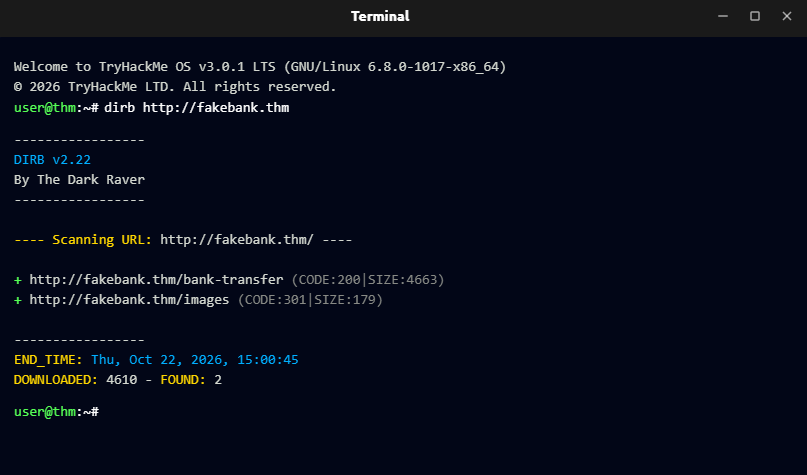
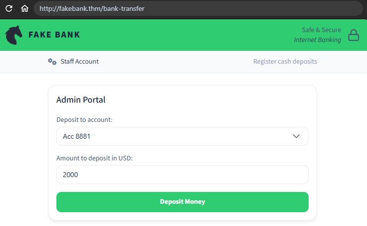

# TryHackMe - Offensive Security Intro

## What is Offensive Security
Offensive Security is when you use the same methods a hacker would use to find vulnerabilities in the company you work for.

## Task: Finding the account number
A fake bank website opens, and the question asks: what is the bank account number shown on the fake site?

**Answer:** `8881`



## Task: Looking for weaknesses on the fake bank site
I opened the terminal and used `dirb` to enumerate hidden directories/files on the site:

```bash
dirb http://example.com
```



**Question:** dirb found 2 URLs. Which one is more likely to give us access to the fake bank's tools?

**Answer:** `http://fakebank.thm/bank-transfer`

I pasted this domain into the search bar, selected the account we found earlier (8881), and made deposits until the account balance became positive.



**Question:** What could the fake bank do to make the bank-transfer page secure?

**Answer:** Require login (i.e., add authentication/authorization so the transfer endpoint isn't publicly accessible).

## What I learned
- Directory brute-forcing tools like `dirb` can reveal hidden or unlinked pages/endpoints on a website.
- An endpoint that performs a sensitive action (like a money transfer) must require authentication — otherwise anyone who finds the URL can use it without permission.
- This is a simple but real example of **broken access control**, a very common web vulnerability.
