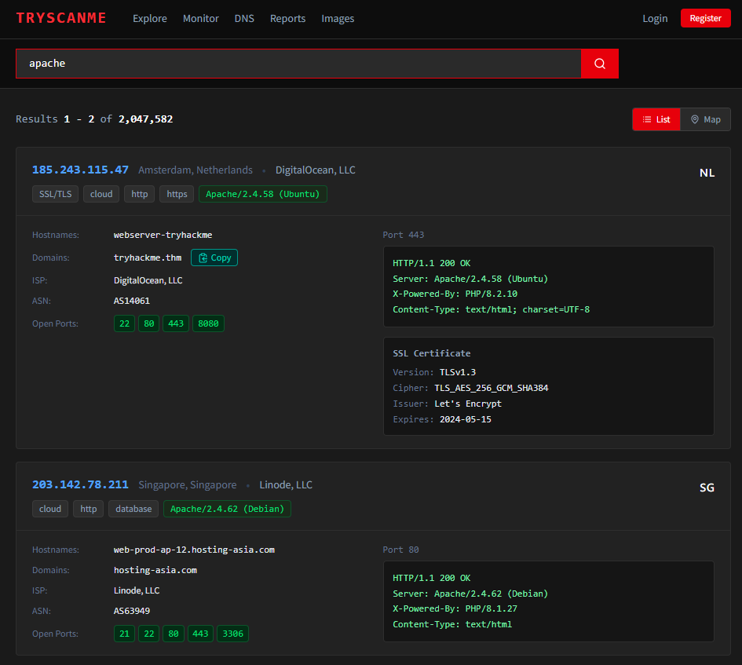
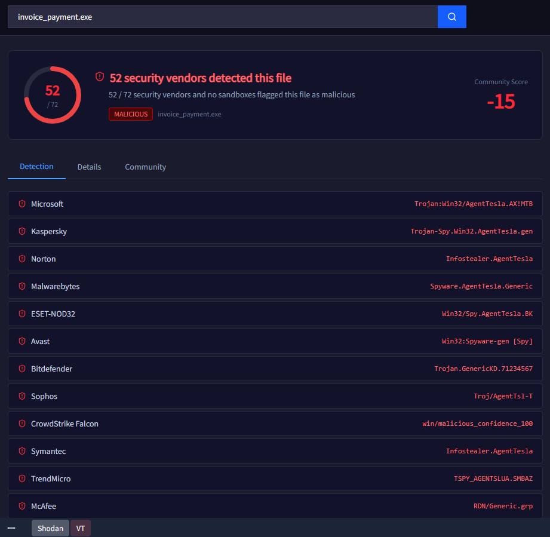
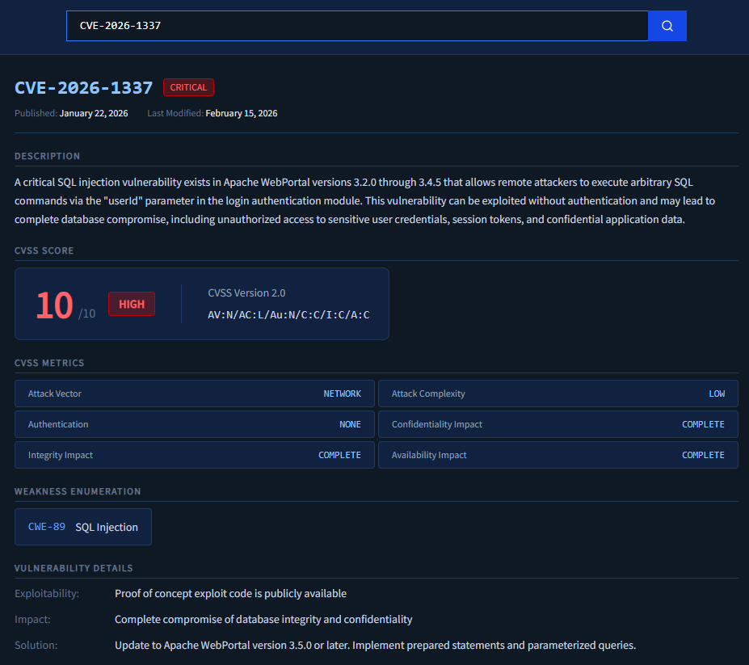
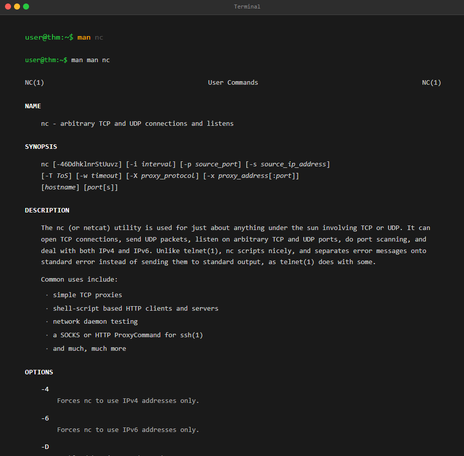
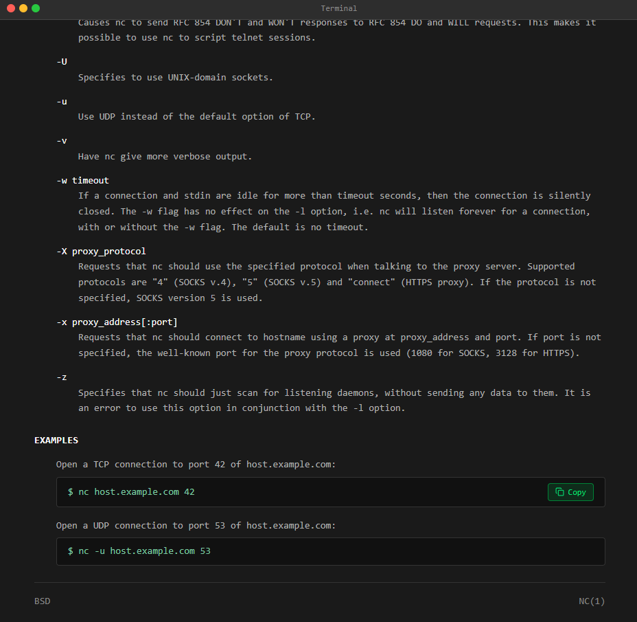
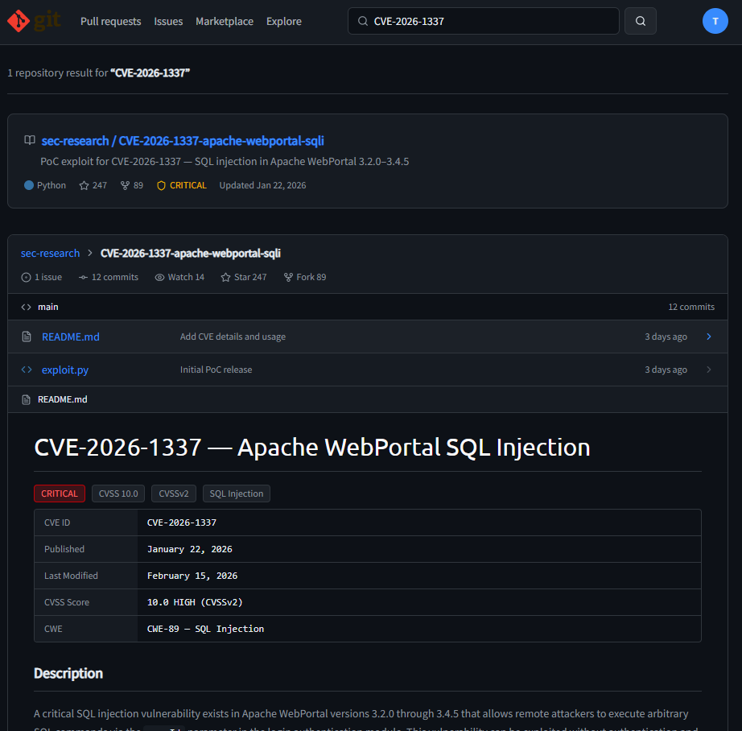

# TryHackMe - Search Skills

## What is this room about
This room covers how to research threats and vulnerabilities using open-source tools: a Shodan-like internet scanner, VirusTotal, the CVE database, `man` pages, and GitHub.

## Task: Scanning the internet with TryScanMe
TryScanMe is described as a search engine for the Internet of Things. It scans the internet, searching for networking equipment, traffic cameras, and virtually anything else with a public network connection, to see what is running and where.

Searching `apache` returns a list of servers advertising that software in their HTTP headers. This is useful when paired with a known CVE affecting a specific version.

**Question:** What domain is associated with the IP address `185.243.115.47`?

**Answer:** `tryhackme.thm`

## Task: Checking a file with VirusTotal
VirusTotal collates results from many antivirus engines and websites into a single interface. It will tell you whether any of those engines have flagged a file as malicious or not.

**Question:** How many security vendors have identified the file as dangerous?

**Answer:** `52`

## Task: Looking up a CVE
The Common Vulnerabilities and Exposures (CVE) programme is the closest thing in the industry to a universal dictionary of known vulnerabilities.

Confirmed vulnerabilities are identified in the format `CVE-YEAR-NUMBER`. Very impactful vulnerabilities may get a nickname, like Heartbleed, React2Shell, or Log4Shell. These are given a score (CVSS) based on factors such as:

- **Impact**, what damage can it lead to?
- **Complexity**, is it easy to exploit?
- **Availability**, how likely is it that someone can exploit this?

Organizations use this score to prioritize their level of risk. These identifiers let researchers, security tools, and others make sure they're discussing the same issue.

Now I'll interact with a vulnerability database and search for `CVE-2026-1337`.

**Question:** What CVSS (Common Vulnerability Scoring System) classification did the vulnerability get?

**Answer:** `10`

## Task: Reading documentation with `man`
When troubleshooting unexpected behaviour or trying to understand how to use a tool, we should first search for the official documentation.

In Linux, we can open the terminal and run `man <command>` to see the manual page for the command we need. I'll search for the manual page for `nc` (netcat).

I need to find the example command that opens a connection to `host.example.com` on port 42.

**Question:** What is the example command?

**Answer:** `nc host.example.com 42`

## Task: Researching a CVE on GitHub
GitHub can be a great resource for staying updated on threats and vulnerabilities. Researchers publish proof-of-concept code there, often faster than through official channels.

We can search for a CVE identifier directly on GitHub. Sometimes PoC repositories are malicious or intentionally flawed, so it's important to always verify what you're about to execute before running it.

I'll search for `CVE-2026-1337` and look at the repository.

**Question:** What is the name of the script in the repository that demonstrates the vulnerability?

**Answer:** `exploit.py`

## What I learned
- Internet-wide scanners like Shodan (and similar tools) let you find exposed devices and services by software version, which is useful for correlating known vulnerabilities with real targets.
- VirusTotal is a fast way to check whether a file has already been identified as malicious by multiple antivirus engines, without running it yourself.
- CVE identifiers and CVSS scores give everyone, like researchers, vendors and defenders, a shared, standardized way to talk about and prioritize the same vulnerability.
- `man <command>` is the fastest, most reliable way to check a tool's real options and usage instead of guessing or relying on outdated blog posts.
- GitHub often has proof-of-concept exploits before official advisories are fully published, but PoC code should always be reviewed before execution since it can be malicious or intentionally broken.
