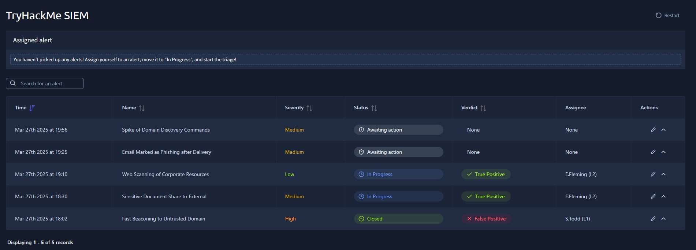
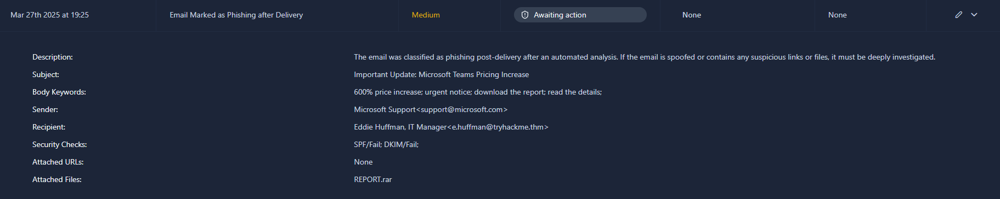
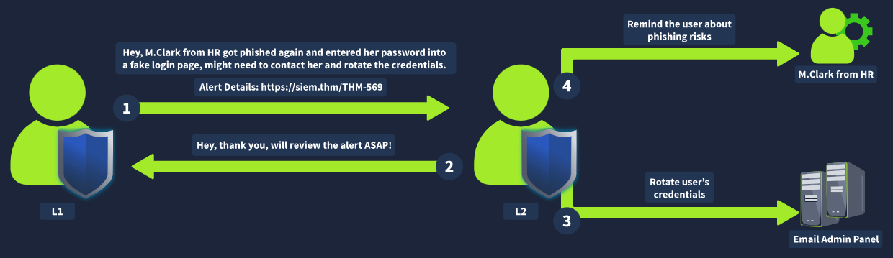
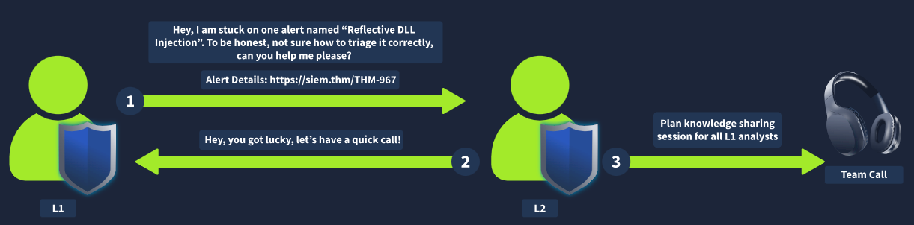
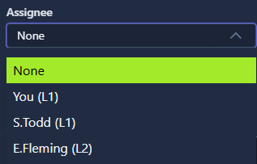
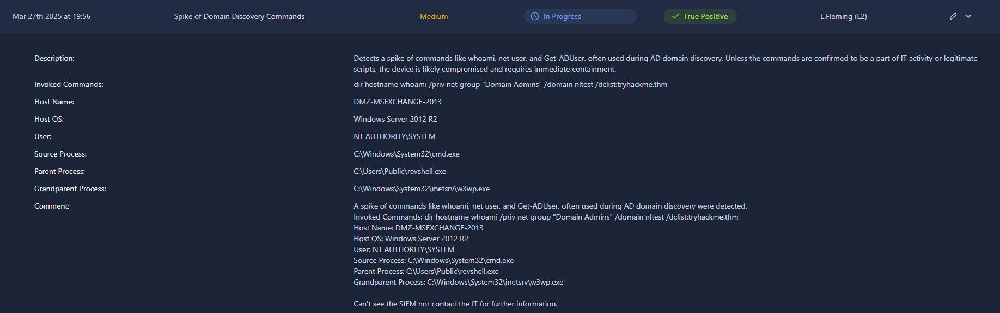
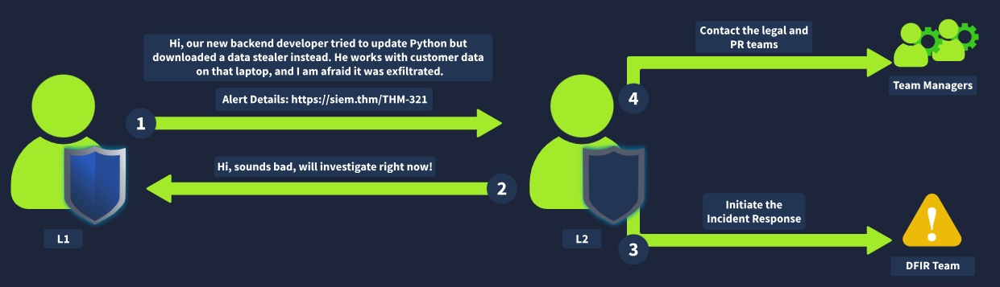

# TryHackMe - SOC L1 Alert Reporting

During or after triage, L1 analysts can still be unsure how to classify an alert, and may need information from senior support or the system owner.

In the last room I learned how to classify and triage alerts, but I still didn't know what happens next, and how triage actually helps prevent threats and stop breaches.

L1 analysts first receive an alert in a SIEM, EDR, or ticketing platform. Most alerts get closed as false positives or handled directly at the L1 level, but anything threatening or complex gets sent to L2, who remediates most real breaches. To send an alert further, I need to understand three things: reporting, escalation, and communication.

## Task: Alert reporting
Before closing an alert or passing it to L2, I need to report on it. Depending on the team's standard or the alert's severity, instead of a short comment, I might need to document my investigation in detail, including all the relevant evidence. This matters even more for true positives, which need escalation.

## Alert escalation
If a true positive needs further action or deeper investigation, it has to be escalated to an L2 analyst for further review. This is where my alert report comes in handy, since L2 will use it to get the initial context and spend less time starting the analysis from scratch.

## Communication
I might also need to communicate with other departments during or after an analysis, like asking the IT team to confirm whether admin privileges were actually granted to a user, or contacting HR for more information about a new hire.

**Question:** What is the process of passing suspicious alerts to an L2 analyst for review?

**Answer:** `Alert escalation`

**Question:** What is the process of formally describing alert details and findings?

**Answer:** `Alert reporting`

## Task: Reporting guide
Here it explains why anyone would want an L1 analyst to write reports and mark alerts as true or false positive, and why this topic shouldn't be underestimated:

- A well-written report saves the L2 team time and helps them quickly understand what happened
- Raw SIEM logs are only kept for 3 to 12 months, but alerts stay indefinitely, so it's better to keep all the context inside the alert itself
- If you can't explain something simply, you haven't understood it well enough. Writing reports is a good way to sharpen L1 skills by summarising alerts

Report format: picture yourself as an L2 analyst, a DFIR team member, or an IT professional who needs to understand the alert. What would you want to see in the report?

The ideal approach follows the Five Ws, with the report covering at least:
- Who: which user logged in, ran the command, or downloaded files
- What: the exact action or sequence of events that was performed
- When: exactly when the suspicious activity started and stopped
- Where: which device, IP, or website was involved in the alert
- Why: the most important W, the reasoning behind the final verdict

**Question:** According to the [SOC dashboard](https://static-labs.tryhackme.cloud/apps/socl1-alertreporting/), which user email leaked the sensitive document?

**Answer:** `m.boslan@tryhackme.thm`

Even though m.boslan@tryhackme.thm is a real corporate email belonging to an actual employee, it's still the leak, since this account is the one that downloaded the files and sent them to an unknown external address. This can happen when an attacker compromises someone's computer or account through malware, for example.

**Question:** Looking at the new alerts, who is the "sender" of the suspicious, likely phishing email?

**Answer:** `support@microsoft.com`

This one's fairly obvious, since the report itself has a Sender field.

**Question:** Open the phishing alert, read its details, and try to understand the activity. Using the Five Ws template, what flag did you receive after writing a good report?

First, I assign the alert to myself and set it to in progress.

I notice that support@microsoft.com is a real Microsoft domain, with no alteration that could be mistaken for something else. But the subject line being urgent, claiming a 600% price increase, and asking to download a file called REPORT.rar is extremely strange. Nothing confirms that Microsoft itself couldn't be compromised one day too, so I mark this as a true positive.

**Answer:** `THM{nice_attempt_faking_microsoft_support}`

## Task: Escalation guide
Once the verdict is set and the alert report is written, I need to decide whether it gets escalated to L2. The answer can differ from team to team, but a few general recommendations fit most SOC teams:

1. The alert is an indicator of a major cyberattack that needs deeper investigation or DFIR
2. Remediation actions like malware removal, host isolation, or a password reset are needed
3. Communication with customers, partners, management, or law enforcement is required
4. I simply don't fully understand the alert and need help from a more senior analyst

Escalation steps: in most cases, escalating an alert means reassigning it to the L2 on shift and notifying them, either in a corporate chat or in person. Some teams require a formal escalation request with a dozen or so required fields.

Requesting L2 support: it's generally common for an L1 to ask for help or senior support when something isn't clear. Especially in the first few months, it's always better to discuss an alert and clarify SOC procedures than to blindly close an alert you didn't fully understand on your own. The flow usually looks like this:

**Question:** Who is your current L2 in the [SOC dashboard](https://static-labs.tryhackme.cloud/apps/socl1-alertreporting/) that you can assign (escalate) the alerts to?

**Answer:** `E.Fleming`

He's the only L2 on the list.

**Question:** What flag did you receive after correctly escalating the alert from the previous task to L2?

I realize now that I actually should have escalated that alert. Without a SIEM, and with only the alerts tab to work from, there's no way for me to know whether the user actually downloaded and opened the file, so if I'm not sure, the right call is to escalate. I edited the alert, set the assignee to L2, and reopened it, since I had closed it.

**Answer:** `THM{good_job_escalating_your_first_alert}`

**Question:** Now, investigate the second new alert and provide a detailed alert comment. What flag did you get after escalating this alert according to the workflow?

First, I assigned the alert to myself and set it to in progress. Then I read through the description and details, copying and pasting most of the information, and added one more comment at the end. After that, I assigned it to L2 and marked it as true positive, since I have no way to check the SIEM or contact the IT team to confirm whether this was something premeditated or just suspicious activity.

**Answer:** `THM{looks_like_webshell_via_old_exchange}`

## Task: SOC communication
In the best-case scenario, the SOC team has its own Crisis Communication procedures, guides and processes that help me and the team solve problems.

Communication cases:
- I need to escalate an urgent, critical alert, but L2 isn't available and hasn't answered in about 30 minutes.
  - I need to know where to find emergency contacts. I try calling L2 first, then L3, and the manager last.
- An alert about a Slack/Teams account compromise needs me to validate the login with the affected user.
  - I shouldn't contact the user through the breached chat account, and should use an alternative contact method instead, like a phone call.
- I get a huge number of alerts in a short period of time, some of them critical.
  - I should prioritise the alerts according to the workflow, but also let the L2 on shift know about the situation.
- A few days later, I realize I misclassified an alert and probably missed a malicious action.
  - I immediately contact L2 and explain the situation. Threat actors can stay quiet for weeks before causing any real impact.
- I can't finish triaging an alert because the SIEM logs aren't parsed correctly or aren't searchable.
  - I don't skip the alert. I investigate as much as I can and report the issue to the L2 on shift or the SOC engineer.

This last one answers an earlier question, where I closed an alert without a SIEM or any other way to research it, which was the wrong call, since I should have escalated it instead.

Communication by L2:

**Question:** Should you first try to contact your manager in case of a critical threat?

**Answer:** `No`

As an L1, I should contact L2 first, and the SOC engineer before the manager.

**Question:** Should you immediately contact your L2 if you think you missed the attack?

**Answer:** `Yes`

## What I learned
- An alert report isn't just a formality. It's the long-term record of what happened, since raw SIEM logs eventually age out while the alert itself stays indefinitely.
- The Five Ws (who, what, when, where, why) give a simple checklist for making sure a report is actually complete, not just "looks done."
- Escalating isn't only for alerts you're sure are malicious. Not having enough visibility, like no SIEM access or no way to confirm something with IT, is itself a valid reason to escalate rather than guess.
- A real corporate domain or a real employee's email address doesn't rule out that account being the source of a leak. A legitimate account can be the one compromised and used to exfiltrate data.
- Escalation has a chain: L1 goes to L2 first, then the SOC engineer, and only then to the manager, even for a critical threat.
- Communication problems, like an unreachable L2, a compromised chat account, or a flood of alerts, have their own playbook, separate from the technical triage itself.
