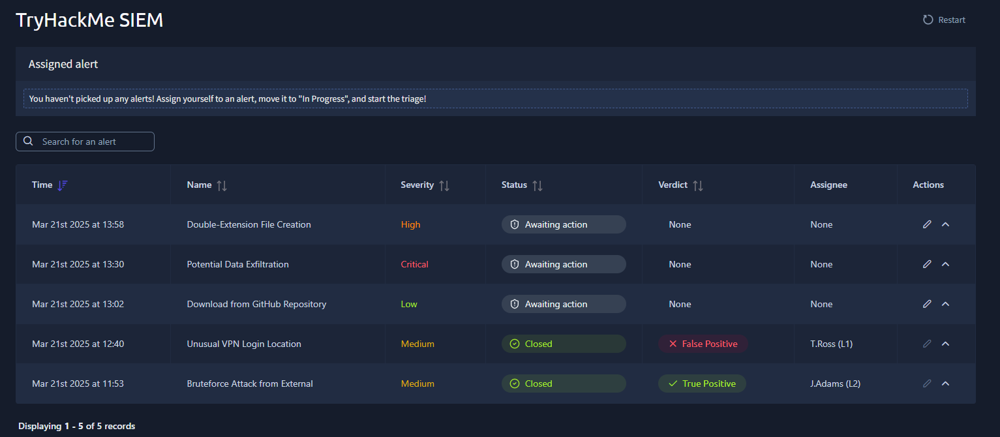
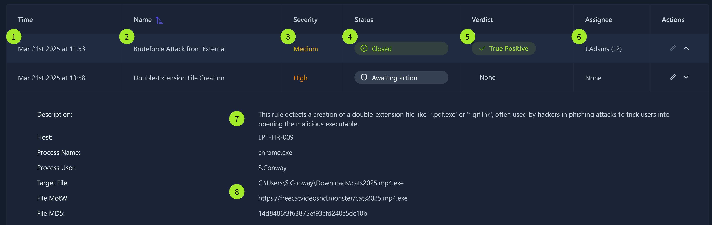
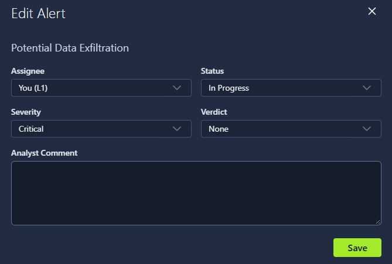
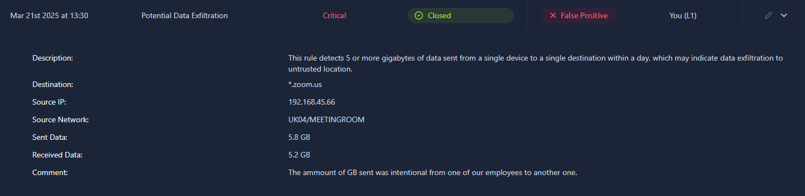
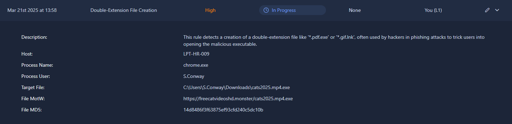
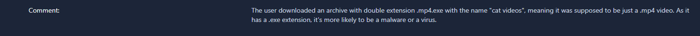
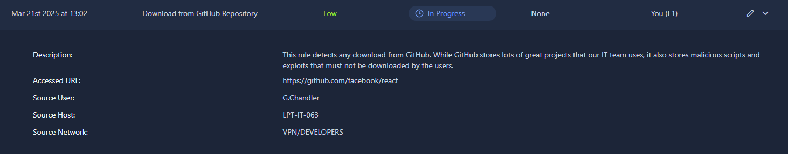
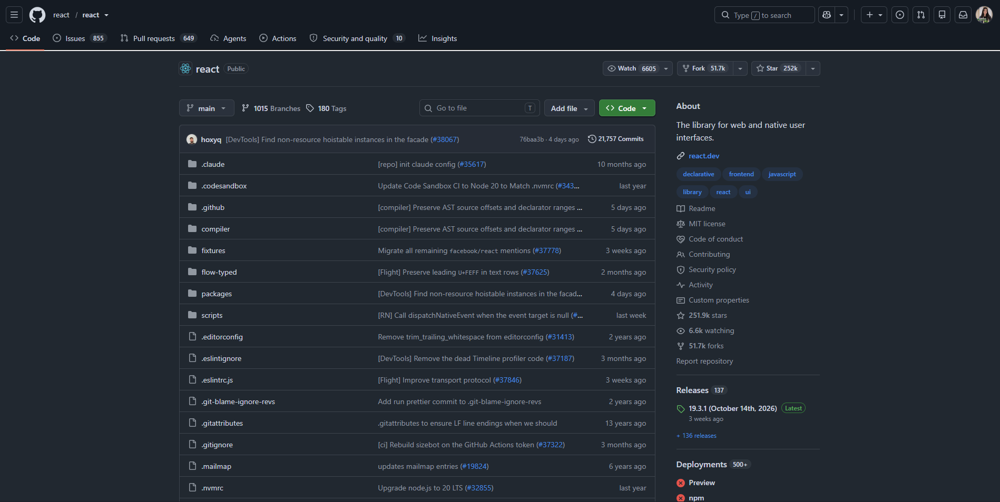
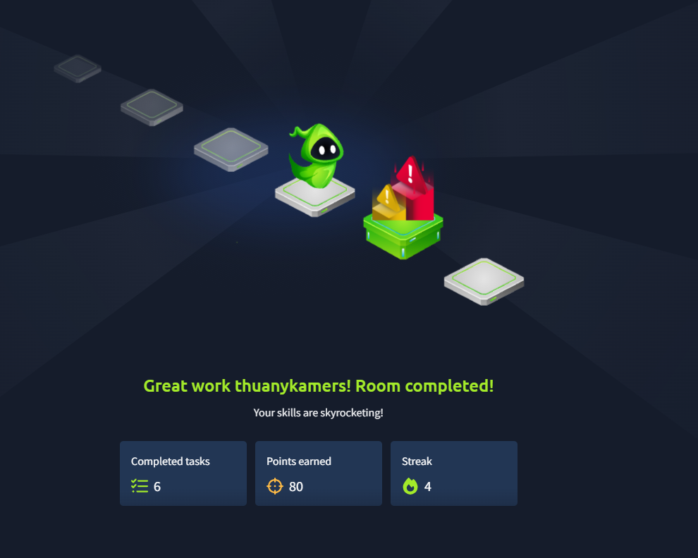

# TryHackMe - SOC L1 Alert Triage

First, an event has to happen, like a file download or a user login. Then a system, such as the OS, a firewall, or a cloud provider, logs that event. All of those logs get sent to a security solution, like a SIEM or an EDR. A SOC team can receive millions of logs a day from thousands of different systems, and while most events are expected, some need attention. An alert, a notification generated by the security solution when a specific event or sequence of events happens, is what saves the SOC analyst from manually reviewing logs, by highlighting only the suspicious, anomalous ones. With alerts, analysts triage a few dozen of them a day instead of millions of raw logs.

SOC L1 analysts are the first line of defense, and the ones who work with alerts the most. They can get anywhere from zero to hundreds of alerts a day, any of which could reveal a real attack. Still, everyone on the SOC team is involved in triaging alerts in some way:

- SOC L1 analysts: review alerts, tell the bad ones from the good ones, and notify L2 analysts when there's a real threat
- SOC L2 analysts: receive alerts escalated by L1 and perform deeper analysis and remediation
- SOC engineers: make sure alerts carry enough information for an efficient triage
- SOC manager: track the speed and quality of alert triage to make sure real attacks don't get missed

## Task: Reading the SOC dashboard
**Question:** What is the number of alerts in the SOC dashboard?

**Answer:** `5`

**Question:** What is the name of the most recent alert you see?

**Answer:** `Double-Extension File Creation`

Now I'm going to understand how alerts are generated. The details can differ between SIEMs, but in general alerts have a set of main properties I need to understand first.

Below that there's a table explaining each number from the image.

**Question:** What was the verdict for the "Unusual VPN Login Location" alert?

**Answer:** `False Positive`

**Question:** What user was mentioned in the "Unusual VPN Login Location" alert?

**Answer:** `M.Clark`

## Task: Alert prioritisation
Now I'm going to learn about alert prioritisation, to understand which alert to pick first.

Every SOC team decides its own prioritisation rules, usually automating them by configuring the right alert sorting logic in the SIEM or EDR. The most common, generic approach is:

1. Filter the alerts. Make sure I don't pick up an alert another analyst already reviewed, or one that's already being investigated. I should only take new alerts that are unseen and unresolved.
2. Sort by severity. Start with critical alerts, then high, medium, and low last. Detection engineers design the rules so that critical alerts are far more likely to be real, major threats that cause much more impact.
3. Sort by time. Start with the oldest alerts and end with the most recent ones. The idea is that if two alerts are about two separate breaches, the attacker behind the older breach is likely already dumping data, while a newcomer has only just started discovery.

**Question:** Should you first prioritise medium over low severity alerts?

**Answer:** `Yes`

**Question:** Should you first take the newest alerts and then the older ones?

**Answer:** `No`

**Question:** Assign yourself to the first-priority alert and change its status to In Progress. The name of your selected alert will be the answer to the question.

**Answer:** `Potential Data Exfiltration`

## Task: Triaging the alerts
Here's the triage cycle:

**Question:** Which flag did you receive after you correctly triaged the first-priority alert?

**Answer:** `THM{looks_like_lots_of_zoom_meetings}`

In this case, since I only had access to this dashboard and not to the SIEM, I just checked that the destination of the 5.8GB transfer was Zoom, a very common corporate app, and a real domain. There wasn't much more information in the comment field, so I wrote down that reasoning, and it turned out to be the correct call, which gave me the flag.

**Question:** Which flag did you receive after you correctly triaged the second-priority alert?

I assigned it to myself first, then read the description. It looked like access to a website where the user apparently wanted to download cat videos in HD, based on the link's name. But a video would only ever have a .mp4 extension, and here there's a double extension instead: .mp4.exe. Being an executable, it's very likely malware or a virus. It was downloaded to C:\Users\S.Conway\Downloads\ under the name cats2025.mp4.exe.

I added that description and closed the alert, which got me the flag.

**Answer:** `THM{how_could_this_user_fall_for_it?}`

**Question:** Which flag did you receive after you correctly triaged the third-priority alert?

This time I opened the link, since it looked like a real link to a GitHub repository.

I can see the repository was created by react itself, a trusted source, and it's the React library, widely used for building user interfaces.

The repository also has a lot of forks and stars, which on its own doesn't guarantee there's nothing malicious in it, but taken together, it's a good sign.

I marked it as a false positive and closed the alert, which gave me the flag for the answer.

**Answer:** `THM{should_we_allow_github_for_devs?}`

## What I learned
- An alert exists to save analysts from reading raw logs one by one. It highlights only the events worth a second look, which is what makes triaging a few dozen alerts a day possible instead of drowning in millions of logs.
- Prioritisation isn't just "pick the newest one." Severity comes first, since a critical alert is far more likely to be a real, high-impact threat, and only after that does age matter, with older alerts going first since that attacker has had more time to act.
- A verdict needs to be backed by something concrete, not just a guess. Checking whether a destination domain is legitimate (like zoom.us) or whether a GitHub repository is the real, trusted one (checking its owner, stars, and forks) is what actually justifies calling something a false positive.
- A double file extension, like .mp4.exe, is a reliable red flag on its own: the real extension is always the last one, and anything ending in .exe disguised as another file type deserves to be treated as likely malware.
- A low severity alert can still turn out fine with a quick check, and a high severity one can still turn out to be real malware. Severity sets the order to work in, not the final verdict.
