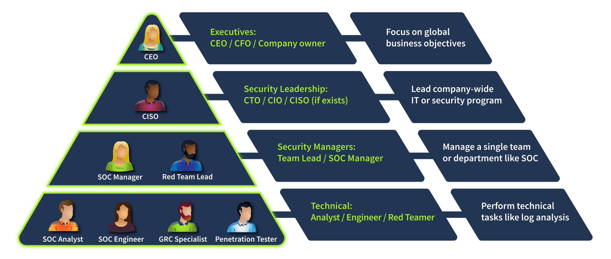
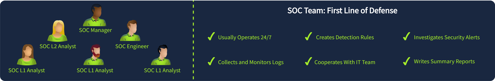
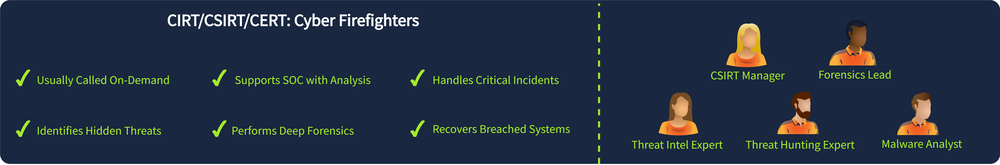
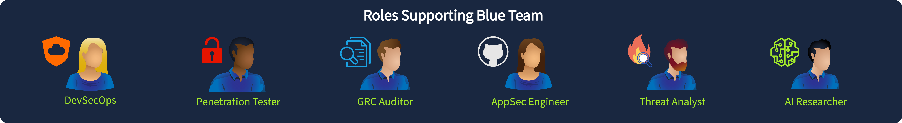
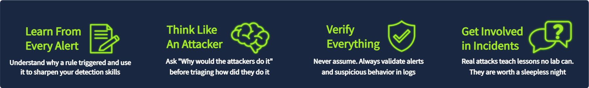

# TryHackMe - SOC Role in Blue Team

## Security Hierarchy
Every company has different priorities when it comes to security. A law firm focuses on document privacy, a hospital focuses on patient safety, a factory focuses on keeping production available. CEOs and CTOs focus on business objectives, not technical details, which is why they hire a CISO to lead the company's security program.

## Security Departments
In small companies, the IT team usually also handles security. In small to medium companies, there's a generic "Information Security" team. In large companies, the CISO oversees multiple specialized teams:
- **Red Team:** offensive security, penetration testers
- **GRC Team:** policy and compliance, like PCI DSS
- **Blue Team:** defensive security, SOC analysts, engineers and incident responders

**Question:** Which senior role typically makes key cyber security decisions?

**Answer:** `CISO`

**Question:** What is the common name for roles like SOC analysts and engineers?

**Answer:** `Blue Team`

## Blue Team departments
Blue Team is about defensive security: monitoring and responding quickly. There are three most common Blue Team departments.

### Security Operations Center (SOC)
The SOC is the first line of defense. It usually operates 24/7, collects and monitors logs, creates detection rules, investigates security alerts, cooperates with the IT team and writes summary reports.

Roles: L1 Analysts triage alerts and escalate complex cases to L2, L2 Analysts investigate advanced attacks, Engineers configure tools like EDR and SIEM, and the Manager manages the whole SOC team.

### Cyber Incident Response Team (CIRT/CSIRT/CERT)
Usually called on demand, this team supports the SOC with deeper analysis and handles critical incidents. It's like calling the firefighters: they're needed when the SOC's expertise isn't enough or the incident is out of control. They need broad threat knowledge and handle breaches without relying only on EDR or SIEM. It's stressful but rewarding work.

Examples: JPCERT (Japan's national CERT), Mandiant (a private global incident response firm), and the AWS CIRT (investigates AWS customer incidents).

**Question:** Does Blue Team focus on defensive or offensive security?

**Answer:** `Defensive`

**Question:** What department handles active or urgent cyber incidents?

**Answer:** `CIRT`

### Specialized Defensive Roles
These are narrower, specialized roles that need deep knowledge of a specific topic.

- **Digital Forensics Analyst:** uncovers threats in disk and memory
- **Threat Intelligence Analyst:** gathers data on emerging threat groups
- **AppSec Engineer:** maintains a secure SDLC
- **AI Researcher:** studies AI threats and defenses

## SOC Path
To start as a SOC L1 analyst, gain and practice the core SOC skills (related skills like red teaming or general IT also help). Be proactive: try CTFs, follow cyber news, consider a certification like SAL1. Prepare for interviews, learn the difference between an internal SOC and an MSSP, and apply for jobs. After working as a junior analyst, prepare to advance to senior roles.

## Internal SOC vs MSSP
Not every organization can operate its own SOC, so many rely on a Managed Services Provider (MSSP), a company that delivers outsourced security services, most commonly a SOC, to its clients. MSSP work is typically high-pressure, but it's a good starting point for a career.

| | Internal SOC | MSSP |
|---|---|---|
| **Scenario Example** | Protects a single organization, with full context of its systems and business | Protects multiple client organizations at once, often with less context on each one |
| **Working Pace** | Can be more focused and in-depth | Usually faster-paced, handling alerts across many clients |
| **Security Tools** | Tools are chosen and tuned for the organization's own environment | Tools need to work across different client environments |
| **Incident Practice** | Sees fewer but more specific incidents for the organization | Sees a higher volume and wider variety of incidents across clients |

## Next Steps
The natural next step from a SOC L1 analyst is SOC L2 analyst, but the career can branch out from there: engineering work, a fascination with CIRT and incident response, or a manager path leading toward CISO. The first year or two in a SOC role is mainly about gaining real experience.

**Question:** How would you call a cyber security company providing SOC services?

**Answer:** `MSSP`

**Question:** Which role naturally continues your SOC L1 analyst journey?

**Answer:** `SOC L2 analyst`

## Final Challenge
In this challenge, I play the CISO of "TrySecureMe," a large multinational, overseeing multiple departments. I need to handle up to 7 simultaneous incidents and assign the right person to each one.

I set it up this way:

It's not possible to take a screenshot after placing the last employee in the correct spot, but it ended up like this.

**Question:** What flag did you claim after completing the final challenge?

**Answer:** `THM{trysecureme_is_secured!}`

## What I learned
- A company's security priorities depend on its industry, and that's why a CISO exists: to translate business priorities into a security strategy that executives don't have time to work out themselves.
- Blue Team isn't just the SOC. It also includes CIRT/CSIRT/CERT for critical incidents and a set of specialized roles (forensics, threat intel, AppSec, AI research) that go deeper into a single area than a general SOC analyst would.
- The SOC path starts with core skills and practice (CTFs, staying current with cyber news), not just a certification, though a certification like SAL1 can help.
- Choosing between an internal SOC and an MSSP career path is a real trade-off: an MSSP sees more volume and variety of incidents across clients, while an internal SOC goes deeper into one organization's own environment.
- Assigning the right role to the right incident (SOC L1 for triage, SOC L2 for deeper analysis, CERT for ransomware, GRC for compliance audits, pentesters for vulnerability checks, engineers for tooling problems, and threat researchers for threat-group analysis) is itself a core CISO-level skill.
