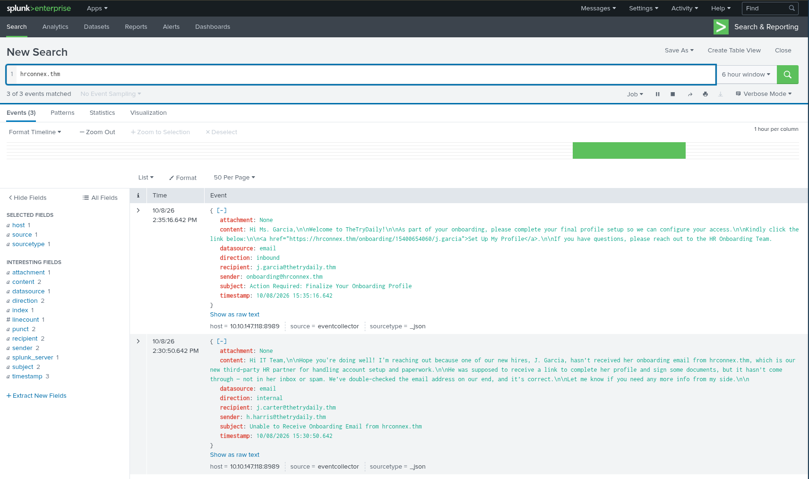
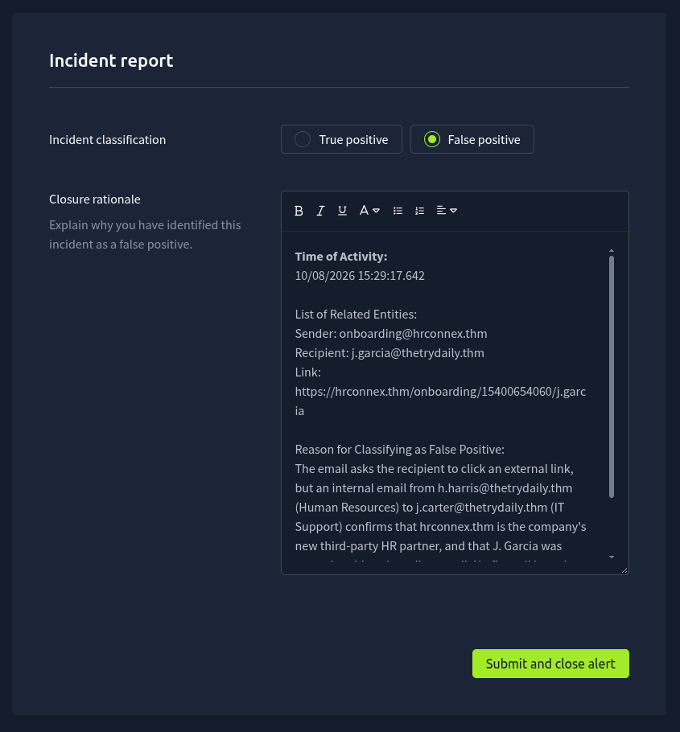
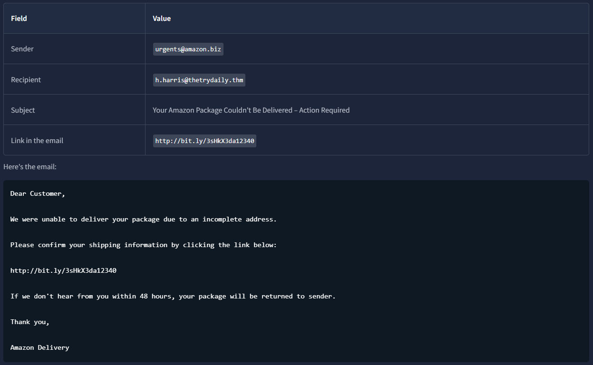
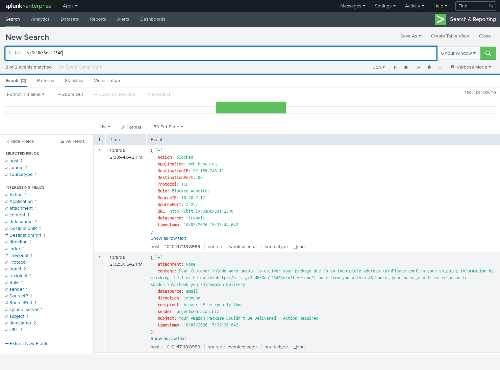
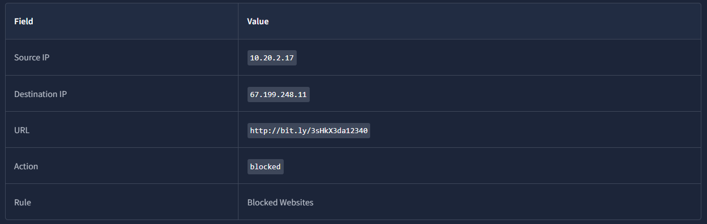
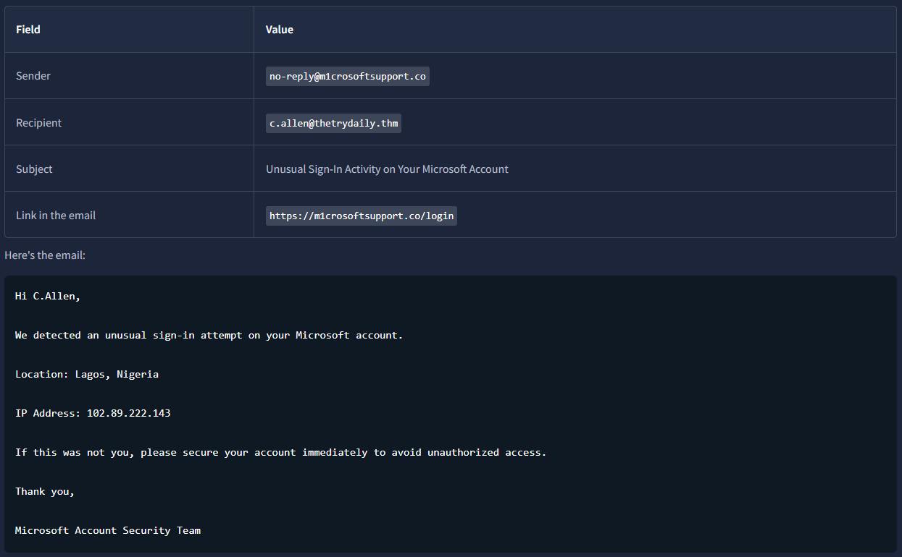
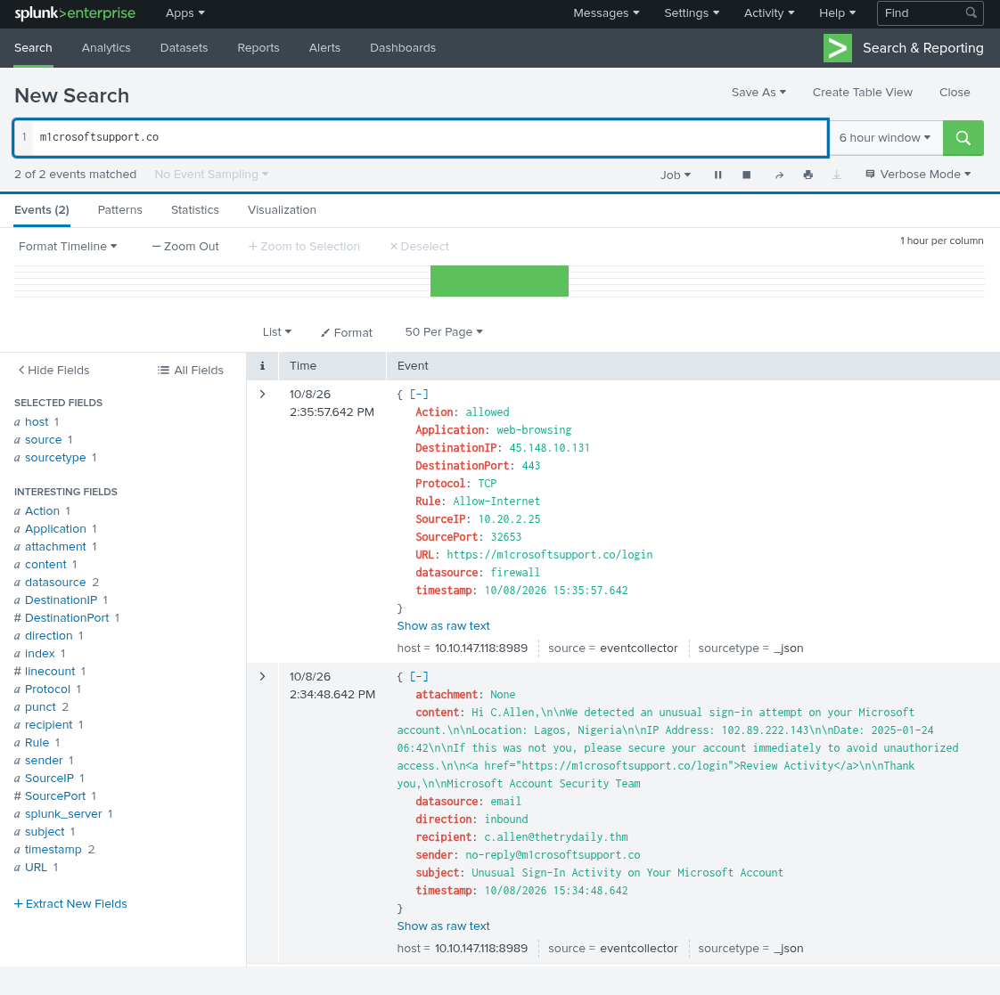

# TryHackMe - SOC Simulator: Introduction to Phishing

It's my first shift as a SOC analyst. My job is to look at each alert and decide what's real and what isn't.

This room explains the simulation I did before, without any background knowledge. Now I'm going to properly understand the steps I should have followed.

The first part, Starting the scenario, goes over each tab I'd already used before, so there's nothing new there.

The second part, How the scenario works, doesn't have anything new for me either. Moving on.

## Task: Onboarding email from hrconnex.thm, a false positive
The third part is the first alert. It starts with a scenario where an email, apparently from HR, asks an employee to finish their onboarding profile through a link.

At first glance it really does look suspicious: it's from outside the company, the subject line says action required, there's a link to click, everything pointing to a possible phishing attempt.

The alert description says exactly what to do: check the firewall or proxy logs to determine whether the link was accessed, and whether the connection was allowed or blocked.

Before that, we need to find out who the sender is, so we open the SIEM. We should search for the sender's domain, which in this case is hrconnex.thm (what comes after the @).



I hadn't done this step in the simulation, hadn't even thought of it. Interesting.

The results show an email exchange between two employees at the company (domain thetrydaily.thm), with the subject "Unable to Receive Onboarding Email from hrconnex.thm." Part of the email reads: "I'm reaching out because one of our new hires, J. Garcia, hasn't received her onboarding email from hrconnex.thm, which is our new third-party HR partner for handling account setup and paperwork."

So the domain belongs to a newly hired, outsourced HR company.

Now let's check who these people are in the documentation. Hannah Harris works in HR, and Jacob Carter in IT Support. So HR told IT that hrconnex.thm is a real HR partner, and that J. Garcia was supposed to receive their onboarding email.

Now we need to know if anyone tried to open the link. The search I did in the SIEM covers every log, including firewall logs. All the results are a single email, so nobody connected to hrconnex.thm.

This alert is a false positive, then. The email looked suspicious, but the company's HR department confirmed the sender is a real partner, and the email is exactly what they were expecting.

Since it's a false positive, there's nothing to escalate.

## Writing a case report
For false positives, the most important thing is explaining why the activity is legitimate.

To make sure the report is complete, it just needs to cover the 5 Ws:
- Who: the people and machines involved
- What: what happened
- When: the time of the activity
- Where: where it happened, like the source and destination of a connection
- Why: the reason behind it, such as what an attacker was trying to do, or why the activity is legitimate

Example:

```
Time of Activity:
______ [the onboarding email's timestamp field in the SIEM]

List of Related Entities:
Sender: ______
Recipient: ______
Link: ______

Reason for Classifying as False Positive:
The email asks the recipient to click an external link, but an internal email
from ______ (Human Resources) to ______ (IT Support) confirms that ______ is
the company's new third-party HR partner, and that J. Garcia was expecting
this onboarding email. No firewall logs show any connection to the link.
No further action is needed.
```



Use the event's timestamp field rather than Splunk's Time column. The two can be an hour apart, so pay attention to which one you're copying.

## Task: Amazon phishing email, a true positive
Another alert shows a similar scenario: a suspicious email with an external link.



A few things stand out:
- the domain is amazon.biz, not Amazon's real domain
- the body says dear customer. A real email would normally use the actual username
- the link was shortened with bit.ly, which hides where it actually leads
- the email creates urgency, asking to act within 48 hours. Very common in phishing

That's already enough to classify it as phishing, but the alert description asks for more. And one important question is: did anyone click the link?

We open the SIEM and search for the link.



The log shows a machine with IP 10.20.2.17 tried to open this exact link. Checking the company information tab, that machine belongs to Hannah Harris, the same person who received the email. So she did click it.

But we also see the Action field says blocked. The firewall stopped the connection with a rule called Blocked Websites.

But was Hannah the only one who received this email? We search the SIEM for the sender, urgents@amazon.biz. Only one email comes back, hers, so nobody else received it.

This alert is a true positive. It's a phishing email, sent from a fake domain, trying to get the employee to click a malicious link.

To decide whether to escalate it, we need to think about what actually matters: whether something was harmed, and whether there's still something to be done. Hannah clicked, but the firewall blocked the connection before the link could load. Nothing reached her machine, so there's nothing else to do.

For true positives, the Alert Reporting tab asks for a few more things: who was affected, where and when it happened, the indicators of compromise (IOCs), and what the attacker was trying to do. IOCs are the concrete clues that identify the attack, like the sender's address, a domain, a URL, or an IP address.

The 5 Ws always need to be answered. The closure rationale template looks like this:

```
Time of activity:
From ______ to ______ [the phishing email's and the firewall event's
timestamp fields in the SIEM]

List of Affected Entities:
User: ______
Source IP: ______
Destination IP: ______
Email from: ______, subject: "Your Amazon Package Couldn't Be Delivered,
Action Required"

Reason for Classifying as True Positive:
The email pretends to be an Amazon delivery notice. The sender's domain is
not Amazon's, the greeting is generic, the link is shortened, and the email
pressures the recipient to act within 48 hours. It asks the recipient to
confirm their shipping information through the link, so the attacker is
after their personal details. The user clicked the link, but the firewall
______ the connection.

Reason for Escalating the Alert:
No escalation needed. ______ [why nothing more needs to be done] No other
employee received an email from ______.

Recommended Remediation Actions:
______ [what, if anything, should be done next]

List of Attack Indicators:
URL: ______
Sender: ______
Destination IP: ______
Source IP: ______
```

## Task: Blocked firewall connection, the other half of the same story
Now there's an alert that came in right after the Amazon email, this time with a different rule: Access to Blacklisted External URL Blocked by Firewall. This one didn't come from the email logs, it came from the firewall.



It's the same firewall log from the last task. This alert is the other half of the same story: Hannah received a fake Amazon email, clicked the link, and the firewall blocked it.

By this point in the investigation we already know most of it. Now let's confirm the pieces:

1. Who is 10.20.2.17? Checking the company information tab, it's Hannah Harris's machine, win-3457, from HR.
2. Where did it come from? Searching the link in the SIEM, we find the Amazon phishing email sent to h.harris@thetrydaily.thm, followed by a firewall log.
3. What's the destination? We check the destination IP with TryDetectThis, searching for 67.199.248.11 (the link's destination), and it comes back malicious. The link isn't just suspicious-looking, it actually leads somewhere known to be bad.
4. Did anyone get in? Searching the SIEM for 10.20.2.17 also turns up an earlier Google search from Hannah's machine, which is normal browsing. Searching for 67.199.248.11, the link's destination, the blocked connection from 10.20.2.17 is the only result, so no other machine tried to reach the link.

This alert is a true positive. An employee really did try to open the malicious link from a phishing email. It's not legitimate activity, even though it was stopped.

It doesn't need to be escalated, because the connection was blocked before it loaded, nothing reached Hannah's machine.

## Task: Microsoft sign-in phishing, a true positive that needs escalation
The next alert is an inbound email with a suspicious external link.



You can tell the email domain, m1crosoftsupport.co, has the number 1 in place of the i. It isn't a Microsoft domain, it's made to look like one at a glance.

The email was also built to create fear. It reports a sign-in from another country, gives a specific IP to make it look real, and offers a button to secure the account immediately. The button leads to a fake page, where the attacker is hoping the user will type in their real email and password.

So, after analyzing it, this is phishing again. The question is: did anyone click it?

We search the SIEM for m1crosoftsupport.co.



This time, we find a firewall log of 10.20.2.25 connecting to https://m1crosoftsupport.co/login at IP 45.148.10.131. And this time the Action field says allowed.

Checking the company information, 10.20.2.25 is Charlotte Allen's machine, win-3463, the same person who received the email. So she clicked the button, and this time the firewall didn't stop it. Her machine connected to the fake login page.

Now we check the destination IP. In TryDetectThis, we search for 45.148.10.131, and it comes back malicious. So Charlotte's machine connected to a server known to be malicious.

This alert is a true positive: a phishing email from a lookalike domain, designed to steal Microsoft users' passwords.

This one does need to be escalated. Charlotte's machine connected to the fake page, and the logs can't tell us whether she actually typed in her password or not. If she did, the attacker has it now, which means more needs to happen: a password reset, and checking her account for any sign-ins she didn't make.

The Alert Report should look like this:

```
Time of activity:
From ______ to ______ [the phishing email's and the firewall event's
timestamp fields in the SIEM]

List of Affected Entities:
User: ______ (Web Development)
Source IP: ______
Destination IP: ______
Email from: ______, subject: "Unusual Sign-In Activity on Your Microsoft
Account"

Reason for Classifying as True Positive:
The email impersonates Microsoft from a lookalike domain that replaces the
letter "i" with the number "1". It claims there was an unusual sign-in and
urges the user to "Review Activity" through a link to a fake login page.
Firewall logs show that the user's machine connected to the link, and the
connection was ______. TryDetectThis reports the destination IP as ______.

Reason for Escalating the Alert:
Escalation is required. ______ [what could have happened after the
connection went through]

Recommended Remediation Actions:
______ [what should happen to the user's password and account, and to
the domain]

List of Attack Indicators:
URL: ______
Sender: ______
Destination IP: ______
Source IP: ______
```

Now I understand how to write reports, where to find the IPs, how to search properly, and how to improve my analysis.

## What I learned
- The 5 Ws (who, what, when, where, why) are the backbone of every case report, whether the alert turns out to be a true positive or a false positive.
- A false positive still needs a documented reason, not just a closed alert. Confirming legitimacy, like an internal email between HR and IT, is evidence too, not just a malicious verdict.
- Whether a connection was actually allowed or blocked by the firewall is what decides escalation, not just whether the email itself was phishing.
- The event's own timestamp field inside the SIEM is the one to use in a report, not Splunk's Time column; the two can be an hour apart.
- Checking a suspicious destination IP against TryDetectThis is how you confirm whether a connection that got through actually reached a known-malicious server.
- A single incident can span more than one alert, like a phishing email and the firewall log of someone clicking its link, and a good report ties them together as one story instead of treating them as unrelated events.
